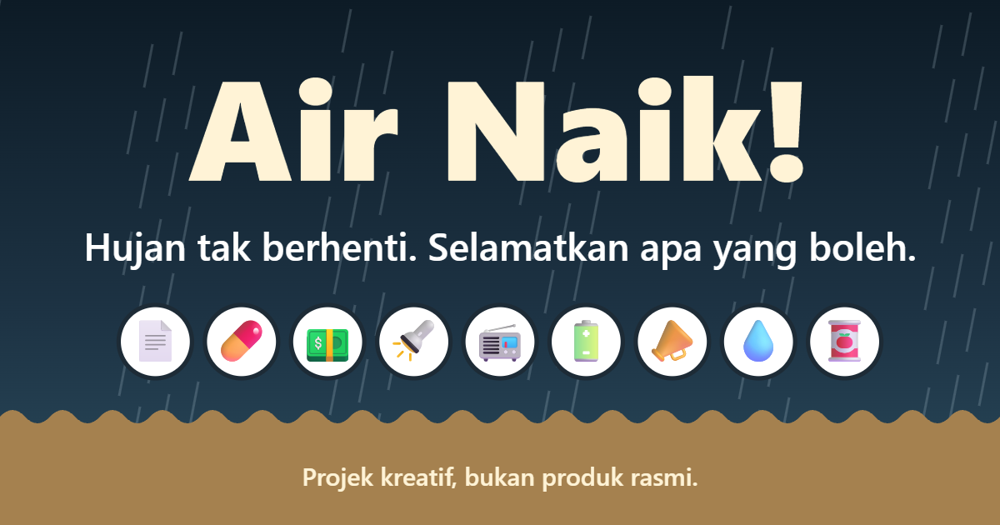

# Air Naik!



**Hujan tak berhenti. Air naik. Awak ada 70 saat dan dua tangan.**
*Rain won't quit and the water's rising. You get about 70 seconds and two hands.*

A tiny arcade game for your phone browser. A kampung house is flooding, and you're the one running up and down the stairs saving the family's stuff. You can't carry everything. Documents or medicine? The TV or the cat? Pick fast, the water doesn't wait.

▶ **[Main sekarang / Play now](https://aizma-alt.github.io/air-naik/)**. No install, no account, no ads. Best on a phone in portrait, fine on desktop too.

*Projek kreatif, bukan produk rasmi.*

---

## How it plays

- **Tap an item** to walk over and grab it. **Tap a high spot** to put it down there.
- **Two hands, real weight.** Light stuff is quick. Heavy stuff slows you down. The fridge takes both hands, and it's probably not worth it.
- **The water is your timer.** No countdown. The flood just climbs through Normal, Waspada, Amaran and Bahaya, one room at a time.
- **Chaos.** The cat bolts. Things float off. Your phone keeps buzzing with messages, and some of them are hoaxes.
- **Get out.** When the rescue boat docks at the roof, whatever you're holding, on the roof deck or in the boat counts. The rest goes with the water.

At the end you get a title for how you played (Beg Siap Awal, Sayang Comot, Hero Peti Sejuk...) and a result card to share with your friends.

No deaths, no ads, no in-app purchases.

## Under the hood

- **Three.js 0.187**, self-hosted and tree-shaken, rendered with an orthographic isometric dollhouse camera.
- **Sim and renderer are separate.** `sim.js` has no Three.js in it, so headless bots can play hundreds of seeded runs for balancing.
- **Seeded runs.** Every layout comes from a seed, so a bug or a lucky run can be replayed exactly.
- **Fast first tap.** Plain HTML paints first, then the 3D scene, then the models and sound stream in. The first tap comes in about 2.3 s on throttled Slow 4G.
- **Baked models.** The Kenney GLBs are baked into one small `models.bin` at build time, so the game ships without a GLTF loader.
- **Sound.** Web Audio synthesizes every sound first. Recorded CC0 files replace them as they load, and a file that fails to load keeps its synthesized version.

## Run it locally

No build step. Serve the folder and open it:

```
npx serve .
```

Dev URL flags:

| Flag | Does |
| --- | --- |
| `?debug` | FPS overlay (average and p5) |
| `?seed=N` | Replay a specific layout |
| `?calm` | Turn the chaos events off |

## Tests and tools

```
npm install
npm test                  # rules check across 200 seeds
node test/balance.mjs     # bot players: lazy, casual and best-case pass lines
node test/browser.mjs     # headless Chromium smoke test (--perf, --review N, --og)
npm run bake              # tools/kenney/*.glb → models.bin
npm run vendor            # rebuild the tree-shaken vendor/three.min.js
```

## Project layout

| File | Role |
| --- | --- |
| `index.html` | Shell, HUD, game loop |
| `data.js` | Items, rooms, wording, timeline, all tuning |
| `sim.js` | Game rules, pathing, water, scoring |
| `render.js` | Camera, animation, effects, tap picking |
| `models.js` | Village and house geometry, `models.bin` loader |
| `audio.js` | Synth and recorded sound, music |
| `share.js` | Result card, Kongsi, link preview image |
| `docs/` | Design doc, item sheet, build stages |

## Credits

Engine: [Three.js](https://threejs.org) (MIT). 3D models and UI sounds: [Kenney](https://www.kenney.nl) (CC0). Ambient and foley sounds: various artists on [OpenGameArt](https://opengameart.org) (CC0). Font: Fredoka (OFL).

Full per-file credits are in [CREDITS.md](CREDITS.md).
